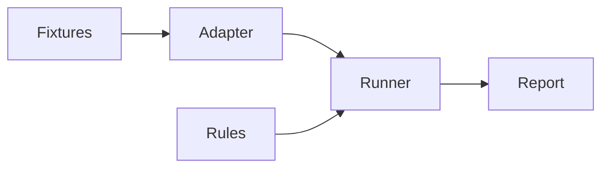

# Accessibility Audit Tool

An admin-facing, read-only screening tool for learning-portal explorations. **Automated checks are advisory screening aids and do not certify WCAG conformance.** It never edits lessons.

## Setup

```sh
npm install
npm run dev
npm test
npm run build
```

## Limitations

This is not a WCAG conformance statement. It checks fixture data, not rendered portal pages, and some results intentionally need human review. Unsupported blocks are disclosed rather than treated as clean.

## Architecture



`FixtureExplorationSource` supplies data; `runAudit` normalizes and evaluates it; report components filter and explain findings.

## Data contract

```json
{"findingId":"welcome:hero:IMG_ALT_MISSING","severity":"violation","evidence":"No alt attribute was provided.","runId":"audit-..."}
```

## Supported heuristics

| Rule | Result |
|---|---|
| IMG_ALT_MISSING | violation |
| IMG_ALT_SUSPICIOUS | needs review |
| HEADING_ORDER | needs review |
| LINK_TEXT_VAGUE | violation for empty; needs review for vague |
| FORM_LABEL_MISSING | violation |

## Verification matrix

| Journey | Coverage |
|---|---|
| Run audit | runner integration tests |
| Locate finding | expandable report row |
| Filter and prioritize | report filter test |
| Review ambiguous issue | needs-review badge |
| Handle partial coverage | unsupported-block disclosure |

## Known limitations and future work

No rendered DOM, keyboard-flow, or media-caption checks are performed. Future work: CSV export, reviewed/dismissed state, Playwright rendered checks, and a real portal adapter.
